# Lab 6: Set Up Nexus Repository and Configure User Access

**Estimated duration:** 2 hours  
**Execution environment:** Run Nexus and all Docker/curl commands directly on the Ubuntu server  
**Previous work:** Reuse the IntelliJ IDEA environment, `java-app` Gradle project and `java-maven-app` Maven project from Lab 5  
**Submission repository:** `DevOps`  
**Submission directory:** `Labs/Lab06`  
**Screenshot directory:** `Labs/Lab06/screenshots`

This lab continues from Lab 5, but Nexus must run directly on the **Ubuntu server**, not inside the IntelliJ container. Use the Ubuntu server terminal for the Nexus `docker run`, `docker ps`, `docker exec`, logs, and user-verification `curl` commands. Reuse the IntelliJ IDEA environment, the `java-app` Gradle project for Task 3 and the `java-maven-app` Maven project for Task 4.

```text
DevOps/
└── Labs/
    └── Lab06/
        ├── README.md
        ├── Lab6_Solution.pdf
        ├── images/                     # Instructor reference images
        └── screenshots/
```

The instructor supplies this README. Create your own screenshots directory and solution PDF.

## Lab Objective

By the end of this lab, you will be able to:

- Reuse the IntelliJ IDEA environment and Gradle project prepared in Lab 5.
- Run Nexus Repository in Docker with persistent storage.
- Complete the initial Nexus administrator setup without exposing credentials.
- Disable anonymous access.
- Create a Nexus role for the Maven snapshots repository.
- Create an active local user and assign the role.
- Verify the user's credentials through the Nexus Status API.
- Configure a Gradle project for Maven publication.
- Build a Java JAR and publish it to the Nexus `maven-snapshots` repository.
- Verify the published Gradle JAR and Maven metadata in Nexus.
- Configure Maven distribution management and authenticated deployment.
- Publish a Maven snapshot JAR and verify it in Nexus.

## Prerequisites

- Complete Lab 5 and keep the existing `Intellij-Idea-docker` environment.
- Keep or reopen the Lab 5 Gradle project at `/config/IdeaProjects/java-app`.
- Keep or reopen the Lab 5 Maven project at `/config/IdeaProjects/java-maven-app`.
- Docker must be installed and running directly on the Ubuntu server.
- Run the Task 1 and Task 2 Nexus container and user-verification commands from the Ubuntu server terminal, not from an IntelliJ terminal or container shell.
- Ports `8006` and `8007` must be available on the Ubuntu Docker host.
- Know the IP address of the Ubuntu computer or server on which Docker is running.
- Use a strong password for the Nexus `admin` account and a different strong password for the `nexus` user.

## Task List

- [Getting Started](#getting-started)
- [Task 1: Run Nexus Repository and Complete the Initial Setup](#task-1-run-nexus-repository-and-complete-the-initial-setup)
- [Task 2: Create a Role and User and Verify Access](#task-2-create-a-role-and-user-and-verify-access)
- [Task 3: Build and Publish the Gradle Application to Nexus](#task-3-build-and-publish-the-gradle-application-to-nexus)
- [Task 4: Publish the Maven Application to Nexus](#task-4-publish-the-maven-application-to-nexus)
- [Task 5: Continue](#task-5-continue)
- [Summary](#summary)
- [Final Submission Checklist](#final-submission-checklist)
- [Submission](#submission)
- [Official References](#official-references)

---

## Mandatory Screenshot and Autograding Rules

Read these rules before starting. Each required screenshot is evaluated separately.

1. Use an Ubuntu account whose terminal prompt shows your registered GitHub username before `@` and `ubuntu` as the hostname:

   ```text
   YourGitHubUsername@ubuntu:~$
   ```

   The comparison is case-insensitive, but the spelling must match the `user_name` registered in the Student Marks Portal.

2. Every terminal screenshot must clearly show:
   - `YourGitHubUsername@ubuntu` in the prompt;
   - the required command; and
   - its relevant result or output.

3. For Nexus browser pages and IntelliJ dialog/editor evidence, keep a terminal showing `YourGitHubUsername@ubuntu` visible in the same screenshot. Keep the required fields, code and results readable.

4. Save every screenshot inside:

   ```text
   Labs/Lab06/screenshots/
   ```

5. Use the exact filename and capitalization given in this document. Do not add numbers or alternative spellings.

6. Screenshots may use any image dimensions, but their text and evidence must be clear and readable.

7. A screenshot containing only a command, only filled but unsaved form fields, or unrelated output is not proof of completion.

8. Do not expose either Nexus password, the generated `admin.password` value, access tokens, private keys, or other secrets in a screenshot or solution file.

9. Exact and visually near-duplicate screenshots are compared across students for the same task. If two students submit the same or slightly modified screenshot, both may receive zero for that task.

10. Commit and push the complete `Labs/Lab06` directory to your `DevOps` repository before the deadline. Files that remain only on your computer cannot be graded.

The images embedded below are **instructor reference images only**. They illustrate the expected Nexus pages, but they are not student evidence. Do not download, copy, edit, or submit these images as your screenshots; capture your own work on your own Nexus server.

### Required Screenshot Filenames

Lab 6 currently requires these 18 screenshots:

```text
nexus_container_running.png
nexus_login_page.png
nexus_setup_complete.png
nexus_role_created.png
nexus_role_privilege.png
nexus_user_created.png
nexus_user_access.png
gradle_nexus_project.png
gradle_jdk_configured.png
gradle_nexus_configuration.png
gradle_nexus_build.png
gradle_nexus_publish.png
nexus_gradle_artifact.png
maven_nexus_project.png
maven_distribution_management.png
maven_package_nexus.png
maven_deploy_nexus.png
nexus_maven_artifact.png
```

Each required screenshot has equal weight.

---

## Getting Started

1. Create the Lab 6 evidence directory in your existing `DevOps` repository:

   ```bash
   cd ~/DevOps
   mkdir -p Labs/Lab06/screenshots
   ```

2. Connect to the Ubuntu server using your registered GitHub username, unless you are already signed in locally:

   ```bash
   ssh <github-username>@<ubuntu-server-ip>
   ```

3. Verify Docker directly on the Ubuntu server:

   ```bash
   docker --version
   docker ps
   ```

4. Keep the Lab 5 IntelliJ IDEA environment and these projects for Tasks 3 and 4:

   ```text
   /config/IdeaProjects/java-app
   /config/IdeaProjects/java-maven-app
   ```

   If either project does not exist, its task explains how to clone it. Do **not** use the IntelliJ container shell to run Nexus. Run every command in Tasks 1 and 2 from the Ubuntu server terminal.

---

## Task 1: Run Nexus Repository and Complete the Initial Setup

### 1. Start the Nexus container

In the Ubuntu server terminal, run:

```bash
docker run -d \
  --name nexus \
  --restart unless-stopped \
  -p 8006:8081 \
  -p 8007:8007 \
  -v nexus-data:/nexus-data \
  sonatype/nexus3:latest
```

This command creates a container named `nexus`. Host port `8006` opens the Nexus web interface, host port `8007` is reserved for a later repository task, and the named volume `nexus-data` keeps Nexus data when the container restarts.

If you previously created the container and it is stopped, do not run the creation command again. Start the existing container with:

```bash
docker start nexus
```

### 2. Verify that Nexus is running

Run:

```bash
docker ps | grep nexus
```

Wait until the output shows the `nexus` container. The first startup can take several minutes. If the browser is not ready yet, inspect startup progress with:

```bash
docker logs -f nexus
```

Press **Ctrl+C** after Nexus finishes starting. This stops only the log display; it does not stop the container.

- Screenshot as `nexus_container_running.png`, showing `docker ps | grep nexus`, the running `nexus` container, and the published ports.

### 3. Open the Nexus login page

On a computer that can reach the Ubuntu Docker host, open:

```text
http://<ubuntu-server-ip>:8006
```

Replace `<ubuntu-server-ip>` with the real IP address. The first login username is:

```text
admin
```

- Screenshot as `nexus_login_page.png`, showing the Nexus login page and the URL. Keep your required terminal prompt visible beside the browser. Do not enter or display a password in the screenshot.

**Instructor reference image:**

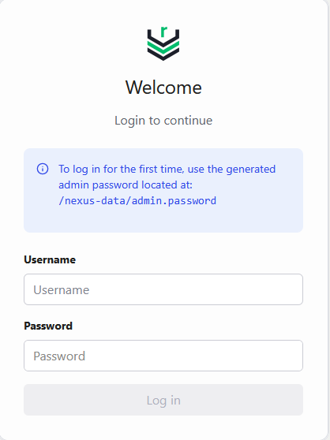

### 4. Retrieve the one-time administrator password

Return to the Ubuntu server terminal and run:

```bash
docker exec nexus cat /nexus-data/admin.password
```

Copy the generated value privately and use it once to sign in as `admin`. **Do not take a screenshot of this command or its output.** Clear the visible terminal immediately afterward:

```bash
clear
```

### 5. Complete the setup wizard

Complete the pages shown by Nexus in this order:

1. Select **Next** on **Let's Get You Set Up**.

   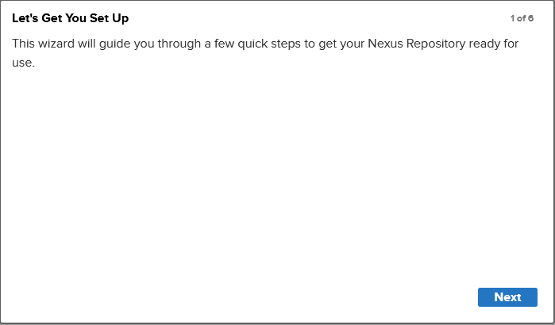

2. Enter and confirm a new strong password for the `admin` user, then select **Next**.

   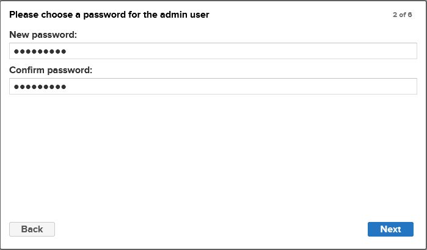

3. Continue with **Nexus Repository Community Edition**.

   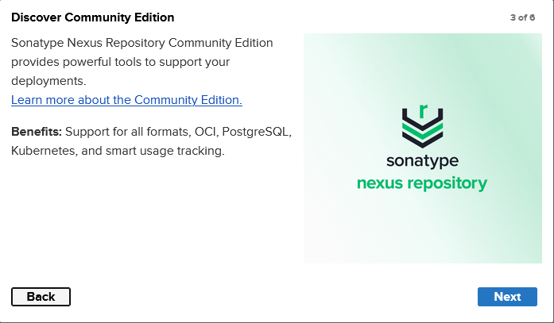

4. Read the End User License Agreement, scroll as required, and select **Agree**.

   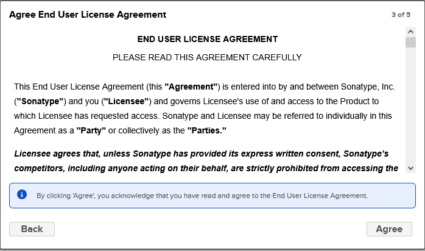

5. On **Configure Anonymous Access**, select **Disable anonymous access**, then select **Next**.

   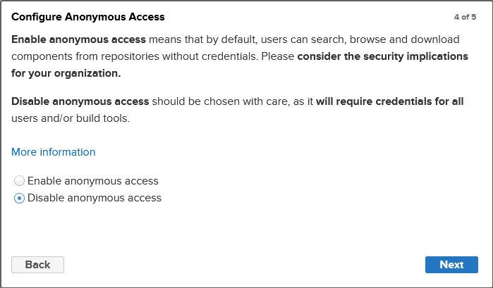

6. On **Setup Complete**, select **Finish**.

   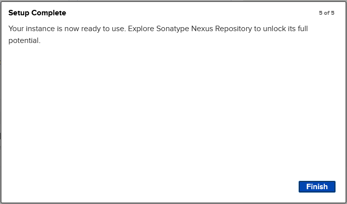

- Screenshot as `nexus_setup_complete.png`, showing the **Setup Complete** page and the Nexus URL. Keep your required terminal prompt visible and do not show either password.

**Screenshot Required:**

- `nexus_container_running.png`
- `nexus_login_page.png`
- `nexus_setup_complete.png`

**Summary:** Nexus is running in Docker with persistent data, the initial administrator password has been replaced, and anonymous access is disabled.

---

## Task 2: Create a Role and User and Verify Access

### 1. Create the `nx-java` role

Sign in as `admin`, open **Settings**, and go to **Security → Roles**. Select **Create Role** and enter:

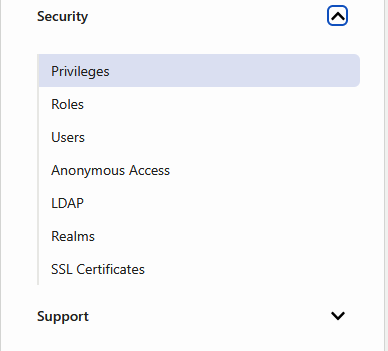

| Field | Value |
| --- | --- |
| Type | `Nexus role` |
| Role ID | `nx-java` |
| Role Name | `nx-java` |
| Role Description | `Maven snapshots role` |

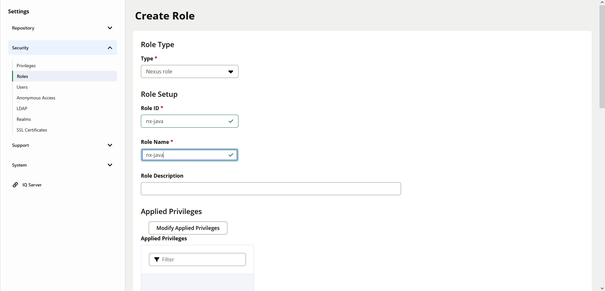

Under **Applied Privileges**, select **Modify Applied Privileges**. Search for `maven2-maven-snapshots`, select this privilege, and confirm the selection:

```text
nx-repository-view-maven2-maven-snapshots-*
```

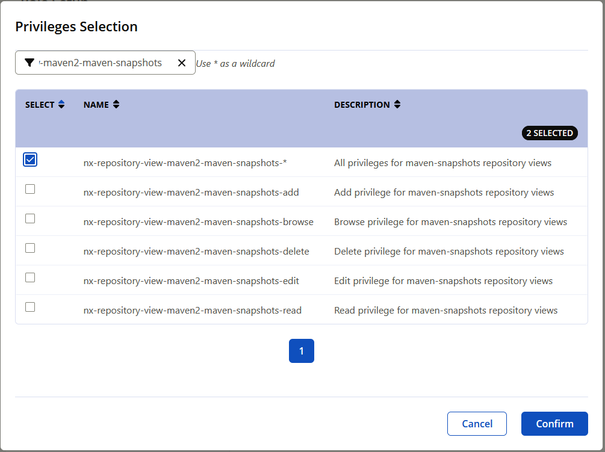

After confirming the selection, verify that the privilege appears under **Applied Privileges**:

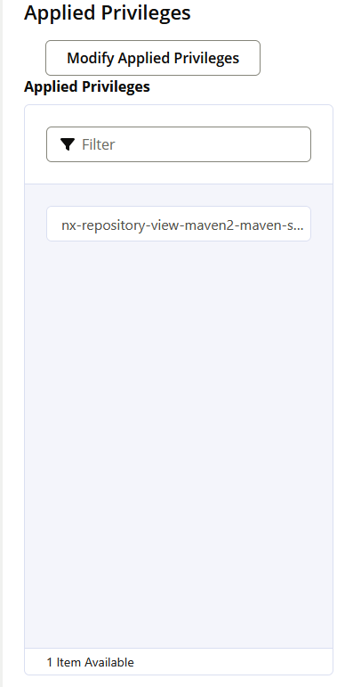

Save the role. Reopen the saved role if necessary to show its details.

- Screenshot as `nexus_role_created.png`, showing the saved role with Role ID `nx-java` and Role Name `nx-java`.
- Screenshot as `nexus_role_privilege.png`, showing `nx-repository-view-maven2-maven-snapshots-*` in the role's saved applied privileges.

### 2. Create the local `nexus` user

Go to **Settings → Security → Users**, select **Create local user**, and enter:

| Field | Value |
| --- | --- |
| ID | `nexus` |
| First name | `nexus` |
| Last name | `dev` |
| Email | `nexus@example.com` |
| Password | A new strong password chosen by you |
| Status | `Active` |
| Granted role | `nx-java` |

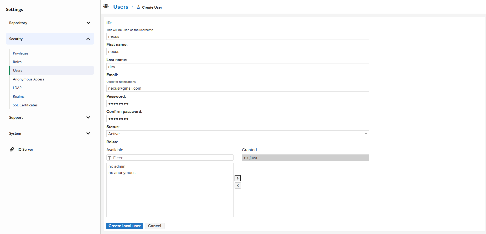

Move `nx-java` from **Available** to **Granted**, then select **Create local user**. Do not reuse the administrator password.

- Screenshot as `nexus_user_created.png`, showing the saved local user `nexus`, Active status, and the granted `nx-java` role. Do not show a password.

### 3. Verify the user's access

In the Ubuntu server terminal, run the following command after replacing `<ubuntu-server-ip>` with the real IP address:

```bash
curl -i -u nexus http://<ubuntu-server-ip>:8006/service/rest/v1/status
```

When curl displays `Enter host password for user 'nexus':`, enter the password created in the previous step. The password is not displayed. Do not place the password after `nexus:` in the command because that would save it in shell history and may expose it in the screenshot.

A successful request returns an HTTP status line containing:

```text
HTTP/1.1 200 OK
```

- Screenshot as `nexus_user_access.png`, showing the curl command, the `HTTP/1.1 200` response, and your required terminal prompt. The password must not be visible.

If the response is `401 Unauthorized`, verify the user ID, password, and Active status. If repository access later returns `403 Forbidden`, verify that `nx-java` is granted to the user and contains the required Maven snapshots privilege.

**Screenshot Required:**

- `nexus_role_created.png`
- `nexus_role_privilege.png`
- `nexus_user_created.png`
- `nexus_user_access.png`

**Summary:** The local `nexus` user is active, receives Maven snapshots access through the `nx-java` role, and can authenticate to Nexus.

---

## Task 3: Build and Publish the Gradle Application to Nexus

Run the Nexus container on the Ubuntu server as configured in Tasks 1 and 2. Perform the project editing, Gradle build and Gradle publication commands in the **IntelliJ IDEA terminal** used in Lab 5.

### 1. Clone or reopen the Gradle project

From the IntelliJ Welcome screen, select **Clone Repository** or **Get from Version Control** and use:

- **URL:** `https://gitlab.com/nanuchi/java-app.git`
- **Directory:** `/config/IdeaProjects/java-app`

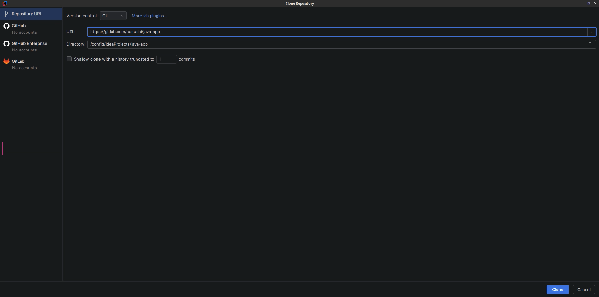

If `/config/IdeaProjects/java-app` already exists from Lab 5, do not create a duplicate clone. Select **Open** or **Recent Projects** and open that existing directory.

- Screenshot as `gradle_nexus_project.png`, showing the successfully opened `java-app` project in IntelliJ.

### 2. Configure the project JDK

In IntelliJ IDEA, select **File → Project Structure**.

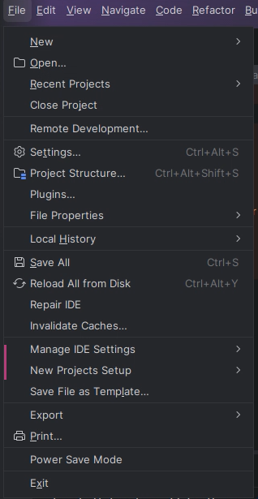

Under **Project Settings → Project**, configure:

| Setting | Required value |
| --- | --- |
| Project SDK | JDK 16 |
| Project language level | `8 - Lambdas, type annotations, etc.` |

If JDK 16 is not listed, open the SDK menu and select **Download JDK**. You may use Azul Zulu or another JDK vendor, but select the architecture that matches your computer. The instructor image uses ARM64 because it was captured on an ARM server; students using `x86_64` must select the matching `x86_64` JDK.

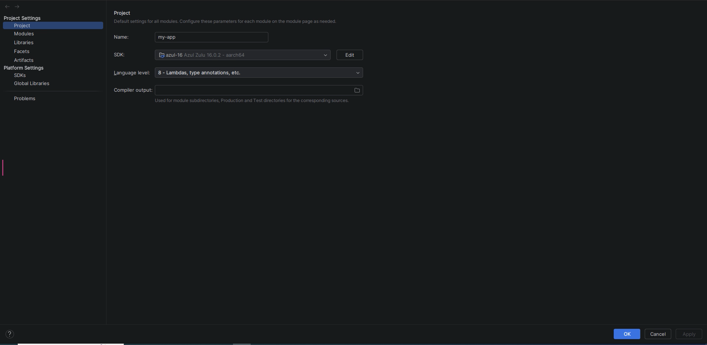

Select **Apply**, then **OK**.

- Screenshot as `gradle_jdk_configured.png`, showing JDK 16 and language level 8 in the saved Project Structure configuration. Keep the required terminal identity visible beside IntelliJ.

### 3. Configure `build.gradle` for Maven publication

Open `build.gradle`. Ensure its `plugins` block contains each plugin exactly once:

```groovy
plugins {
    id 'java'
    id 'maven-publish'
    id 'org.springframework.boot' version '2.2.2.RELEASE'
    id 'io.spring.dependency-management' version '1.0.8.RELEASE'
}
```

Do not add a second `java` or `maven-publish` entry if it already exists.

Keep the project's existing Maven coordinates. Verify that the file contains:

```groovy
group = 'com.example'
version = '1.0-SNAPSHOT'
```

Add the following `publishing` block immediately after the existing `group` and `version` lines. Replace `<ubuntu-server-ip>` with the IP address of the Ubuntu server running Nexus; do not include angle brackets in the final URL.

```groovy
publishing {
    publications {
        maven(MavenPublication) {
            artifact("build/libs/my-app-$version" + ".jar") {
                extension "jar"
            }
        }
    }
    repositories {
        maven {
            name "nexus"
            url "http://<ubuntu-server-ip>:8006/repository/maven-snapshots/"
            allowInsecureProtocol = true
            credentials {
                username project.repoUser
                password project.repoPassword
            }
        }
    }
}
```

`allowInsecureProtocol = true` is required here because this classroom Nexus URL uses HTTP. Do not use this setting as a substitute for HTTPS in a production deployment.

### 4. Set the project name

Open `settings.gradle` and set its contents to:

```groovy
rootProject.name = 'my-app'
```

This name makes the generated JAR begin with `my-app`.

### 5. Create `gradle.properties`

In IntelliJ's **Project** pane, right-click the `java-app` project root and select **New → File**.

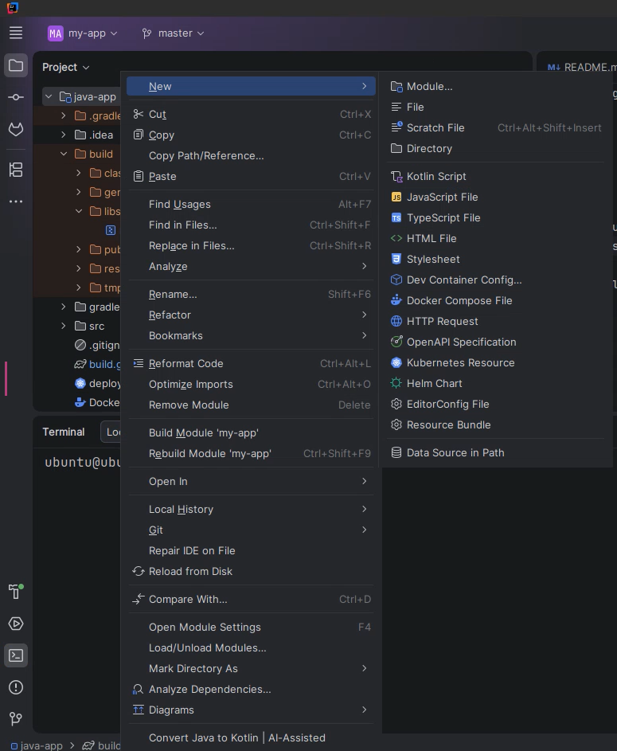

Enter this filename and press **Enter**:

```text
gradle.properties
```

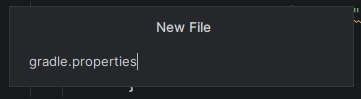

Add these two lines, using the `nexus` user's password created in Task 2:

```properties
repoUser=nexus
repoPassword=<nexus-user-password>
```

Save the project-level `gradle.properties` file. Never display its contents in a screenshot, commit it to Git, include it in `Lab6_Solution.pdf`, or expose its password in terminal output.

- Screenshot as `gradle_nexus_configuration.png`, showing the updated `build.gradle` publication/repository configuration and `settings.gradle`. Keep the required terminal identity visible, but do not show `gradle.properties` or either password.

### 6. Build the JAR

Open IntelliJ's terminal in the `java-app` project and run:

```bash
./gradlew clean build
```

Wait for `BUILD SUCCESSFUL`. In IntelliJ's Project pane, expand `build/libs/` and confirm that it contains:

```text
my-app-1.0-SNAPSHOT.jar
```

- Screenshot as `gradle_nexus_build.png`, showing `./gradlew clean build`, `BUILD SUCCESSFUL`, and the generated `my-app-1.0-SNAPSHOT.jar`.

### 7. Publish the JAR to Nexus

Run:

```bash
./gradlew clean build publish
```

Gradle should run the Nexus publication task and finish with `BUILD SUCCESSFUL`.

- Screenshot as `gradle_nexus_publish.png`, showing the command, the Nexus publish task and `BUILD SUCCESSFUL`. Do not display the credentials file or password.

If publication returns `401 Unauthorized`, verify `repoUser`, `repoPassword` and the Active status of the `nexus` user. If it returns `403 Forbidden`, confirm that the user has the `nx-java` role and that the role contains `nx-repository-view-maven2-maven-snapshots-*`.

### 8. Verify the artifact in Nexus

Open the Nexus web application:

```text
http://<ubuntu-server-ip>:8006
```

Sign in and open the navigation menu if it is collapsed.

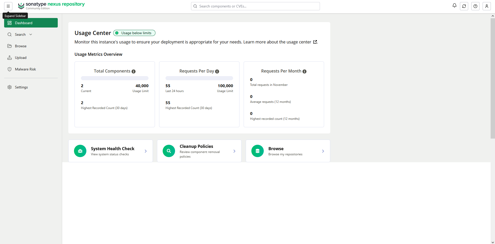

Select **Browse**, then select the hosted `maven-snapshots` repository.

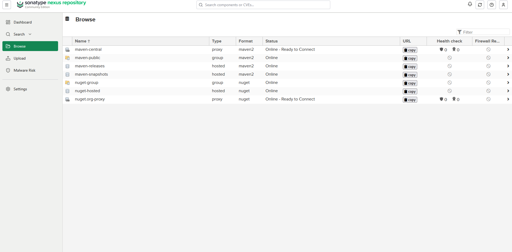

Expand this path:

```text
com → example → my-app → 1.0-SNAPSHOT
```

Expand the `1.0-SNAPSHOT` folder and confirm that Nexus contains the published JAR, POM and Maven metadata/checksum files. Nexus may store the snapshot JAR with a timestamp and build number rather than the literal `SNAPSHOT` filename.

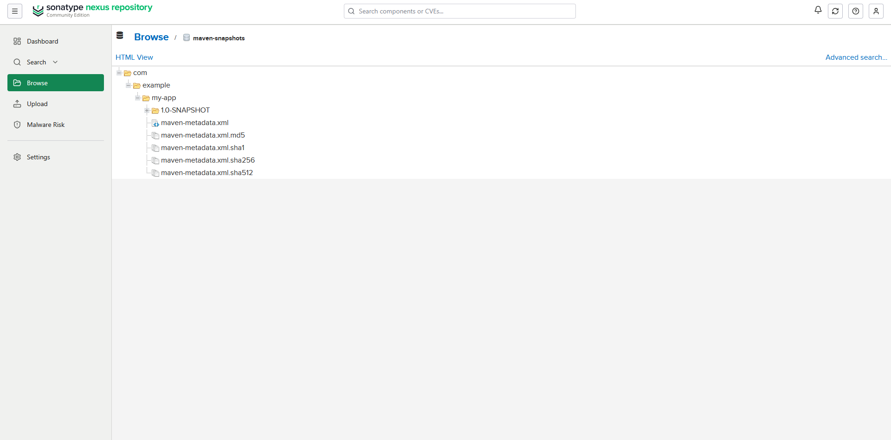

The instructor reference image shows the repository hierarchy and metadata. For your required evidence, expand `1.0-SNAPSHOT` one level further so the JAR filename is also visible.

- Screenshot as `nexus_gradle_artifact.png`, showing `maven-snapshots`, the expanded `com/example/my-app/1.0-SNAPSHOT` path, the published JAR and the metadata. Keep the required terminal prompt visible beside the browser.

**Screenshot Required:**

- `gradle_nexus_project.png`
- `gradle_jdk_configured.png`
- `gradle_nexus_configuration.png`
- `gradle_nexus_build.png`
- `gradle_nexus_publish.png`
- `nexus_gradle_artifact.png`

**Summary:** IntelliJ used JDK 16 to build the renamed `my-app` Gradle project. Gradle read the deployment credentials from the uncommitted project-level `gradle.properties` file and published the snapshot JAR and Maven metadata to Nexus.

---

## Task 4: Publish the Maven Application to Nexus

Keep the Nexus container running on the Ubuntu server. Perform the Maven project editing, packaging and deployment commands in the **IntelliJ IDEA terminal** used in Lab 5.

### 1. Clone or reopen the Maven project

From IntelliJ's Welcome screen, select **Clone Repository** or **Get from Version Control** and use:

- **URL:** `https://gitlab.com/nanuchi/java-maven-app.git`
- **Directory:** `/config/IdeaProjects/java-maven-app`

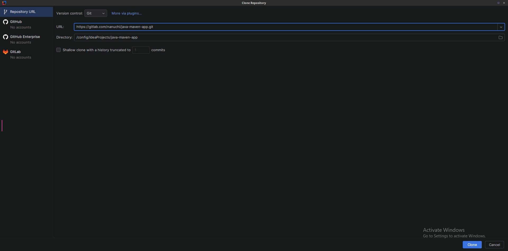

If `/config/IdeaProjects/java-maven-app` already exists from Lab 5, do not clone it again. Select **Open** or **Recent Projects** and open the existing directory.

- Screenshot as `maven_nexus_project.png`, showing the successfully opened `java-maven-app` project in IntelliJ.

### 2. Add snapshot distribution management to `pom.xml`

Open `pom.xml`. Add this block as a direct child of the top-level `<project>` element, immediately after the project's existing `<version>` line. Do not place it inside `<dependencies>` or `<build>`.

Replace `<ubuntu-server-ip>` with the IP address of the Ubuntu server running Nexus. Keep the URL on one line.

```xml
<distributionManagement>
    <snapshotRepository>
        <id>nexus-snapshots</id>
        <url>http://<ubuntu-server-ip>:8006/repository/maven-snapshots/</url>
    </snapshotRepository>
</distributionManagement>
```

The project version ends with `SNAPSHOT`, so Maven uses this `snapshotRepository` when it deploys the artifact.

- Screenshot as `maven_distribution_management.png`, showing the complete saved `distributionManagement` block and the surrounding top-level `pom.xml` structure. Keep the required terminal identity visible.

### 3. Configure the Nexus deployment credentials

Open IntelliJ's terminal and install Vim:

```bash
sudo apt install -y vim
```

Open the Maven settings file:

```bash
vim ~/.m2/settings.xml
```

Press **i** to enter Insert mode and add:

```xml
<settings>
    <servers>
        <server>
            <id>nexus-snapshots</id>
            <username>nexus</username>
            <password>REPLACE_WITH_NEXUS_PASSWORD</password>
        </server>
    </servers>
</settings>
```

Replace `REPLACE_WITH_NEXUS_PASSWORD` with the password created for the `nexus` user in Task 2. The server ID must remain exactly `nexus-snapshots` because it must match the ID in `pom.xml`.

Press **Esc**, type `:wq`, and press **Enter** to save and close Vim.

Never display `settings.xml` in a screenshot, commit it to Git, include it in `Lab6_Solution.pdf`, or expose the password in terminal output.

### 4. Package the Maven application

In IntelliJ's terminal, run:

```bash
mvn package
```

Wait for `BUILD SUCCESS` and verify that Maven creates the snapshot JAR under `target/`.

- Screenshot as `maven_package_nexus.png`, showing `mvn package`, `BUILD SUCCESS`, and the generated snapshot JAR filename.

### 5. Deploy the snapshot to Nexus

Run:

```bash
mvn deploy
```

Maven runs the lifecycle through the deploy phase and uploads the JAR, POM, checksums and metadata to the configured Nexus snapshot repository.

- Screenshot as `maven_deploy_nexus.png`, showing `mvn deploy`, the Nexus upload lines and `BUILD SUCCESS`. Do not show the password or `settings.xml`.

If deployment returns `401 Unauthorized`, verify the username, password and matching `nexus-snapshots` IDs. If it returns `403 Forbidden`, confirm that the `nexus` user is Active and has the `nx-java` role containing `nx-repository-view-maven2-maven-snapshots-*`.

### 6. Verify the Maven artifact in Nexus

Open and sign in to:

```text
http://<ubuntu-server-ip>:8006
```

Select **Browse → maven-snapshots**, then expand:

```text
com → example → java-maven-app → 1.1.0-SNAPSHOT
```

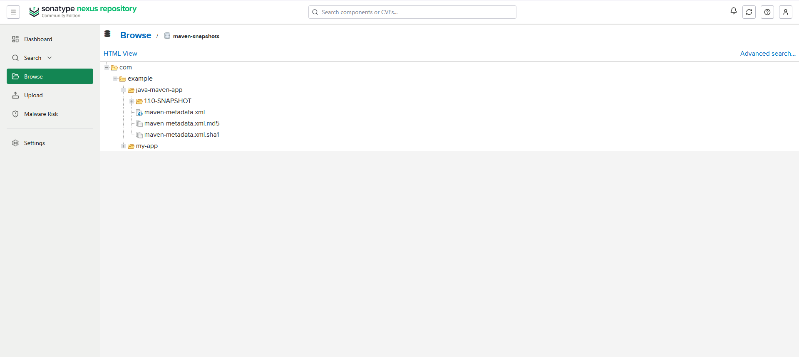

The instructor reference image shows the Maven repository hierarchy and metadata. For your required evidence, expand `1.1.0-SNAPSHOT` so the published JAR, POM and metadata/checksum files are visible. Nexus may use timestamped filenames for the snapshot.

- Screenshot as `nexus_maven_artifact.png`, showing the expanded `com/example/java-maven-app/1.1.0-SNAPSHOT` path, the JAR, POM and Maven metadata. Keep the required terminal prompt visible beside the browser.

**Screenshot Required:**

- `maven_nexus_project.png`
- `maven_distribution_management.png`
- `maven_package_nexus.png`
- `maven_deploy_nexus.png`
- `nexus_maven_artifact.png`

**Summary:** Maven read the deployment destination from `pom.xml`, matched it to the private credentials in `~/.m2/settings.xml`, packaged the snapshot JAR and deployed the artifact and metadata to Nexus.

---

## Task 5: Continue

Additional Task 5 instructions will be added here.


---

## Summary

- You reused the IntelliJ IDEA environment and Gradle project from Lab 5.
- You ran Nexus and its verification commands directly on the Ubuntu server.
- You ran Nexus Repository in a Docker container with a persistent named volume.
- You replaced the generated administrator password and disabled anonymous access.
- You created the `nx-java` role with Maven snapshots privileges.
- You created the active local `nexus` user and assigned the role.
- You verified the user through the Nexus Status API without exposing its password.
- You configured Gradle's Maven Publish plugin and stored the deployment credentials in the project-level `gradle.properties` file instead of hardcoding them in `build.gradle`.
- You built `my-app-1.0-SNAPSHOT.jar` and published it to Nexus.
- You verified the Gradle snapshot JAR and Maven metadata in `maven-snapshots`.
- You configured Maven snapshot distribution and matching private server credentials.
- You packaged and deployed `java-maven-app` to Nexus and verified its JAR, POM and metadata.

## Final Submission Checklist

- [ ] I reused the IntelliJ IDEA environment and the existing `java-app` Gradle project from Lab 5.
- [ ] I ran Nexus and every Task 1 and Task 2 terminal command directly on the Ubuntu server, not inside the IntelliJ container.
- [ ] The `nexus` container is running with ports `8006` and `8007` published.
- [ ] Nexus data uses the persistent `nexus-data` volume.
- [ ] I changed the generated `admin` password and disabled anonymous access.
- [ ] The saved `nx-java` role contains `nx-repository-view-maven2-maven-snapshots-*`.
- [ ] The local `nexus` user is Active and has the `nx-java` role.
- [ ] The authenticated Status API request returned HTTP 200.
- [ ] `build.gradle` contains `java`, `maven-publish`, the Nexus repository URL and the publication block.
- [ ] `settings.gradle` sets `rootProject.name = 'my-app'`.
- [ ] My Nexus credentials are stored in the project-level `gradle.properties` file and are not committed or shown in screenshots.
- [ ] `./gradlew clean build` created `my-app-1.0-SNAPSHOT.jar`.
- [ ] `./gradlew clean build publish` completed successfully.
- [ ] The Gradle snapshot JAR and Maven metadata are visible under `com/example/my-app/1.0-SNAPSHOT` in Nexus.
- [ ] `pom.xml` contains the `nexus-snapshots` distribution-management entry.
- [ ] `~/.m2/settings.xml` contains the matching `nexus-snapshots` server ID and is not committed or shown in screenshots.
- [ ] `mvn package` and `mvn deploy` both completed successfully.
- [ ] The Maven snapshot JAR, POM and metadata are visible under `com/example/java-maven-app/1.1.0-SNAPSHOT` in Nexus.
- [ ] All 18 currently required screenshots use the exact filenames in `Labs/Lab06/screenshots/`.
- [ ] My required Ubuntu terminal identity is readable in every screenshot.
- [ ] No password, generated `admin.password` value, private key, or token appears in any screenshot or solution file.
- [ ] `Lab6_Solution.pdf` contains my identity, captions, and the required evidence in task order.
- [ ] My complete `DevOps/Labs/Lab06` directory is visible on GitHub.

## Submission

Submit the URL of your own `DevOps/Labs/Lab06` directory after all Lab 6 tasks are published and completed.

Do not delete the `nexus` container or the `nexus-data` volume. The next task will continue using them.

## Official References

- [Sonatype: Install Self-Hosted Nexus Repository](https://help.sonatype.com/en/install-nexus-repository.html)
- [Sonatype: Nexus Repository Status API](https://help.sonatype.com/en/status-api.html)
- [Sonatype: Roles](https://help.sonatype.com/en/roles.html)
- [Sonatype: Users](https://help.sonatype.com/en/users.html)
- [Sonatype: Privileges](https://help.sonatype.com/en/privileges.html)
- [Sonatype: Anonymous Access](https://help.sonatype.com/en/anonymous-access.html)
- [Docker Hub: sonatype/nexus3](https://hub.docker.com/r/sonatype/nexus3)
- [Gradle: The Maven Publish Plugin](https://docs.gradle.org/current/userguide/publishing_maven.html)
- [Gradle: Supported Repository Protocols and Credentials](https://docs.gradle.org/current/userguide/supported_repository_protocols.html)
- [Gradle: Java Compatibility](https://docs.gradle.org/current/userguide/compatibility.html)
- [Gradle: Gradle Wrapper](https://docs.gradle.org/current/userguide/gradle_wrapper.html)
- [Maven: POM Distribution Management](https://maven.apache.org/pom.html#distribution-management)
- [Maven: Settings and Server Credentials](https://maven.apache.org/settings.html#servers)
- [Maven: Security and Deployment Settings](https://maven.apache.org/guides/mini/guide-deployment-security-settings.html)
- [Maven: Build Lifecycle and Deploy Phase](https://maven.apache.org/guides/introduction/introduction-to-the-lifecycle.html)
