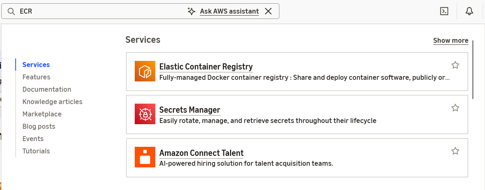
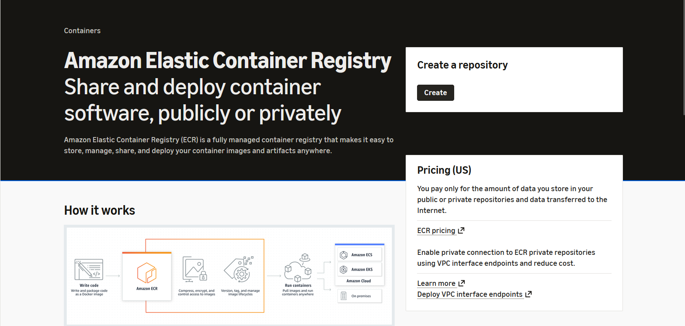
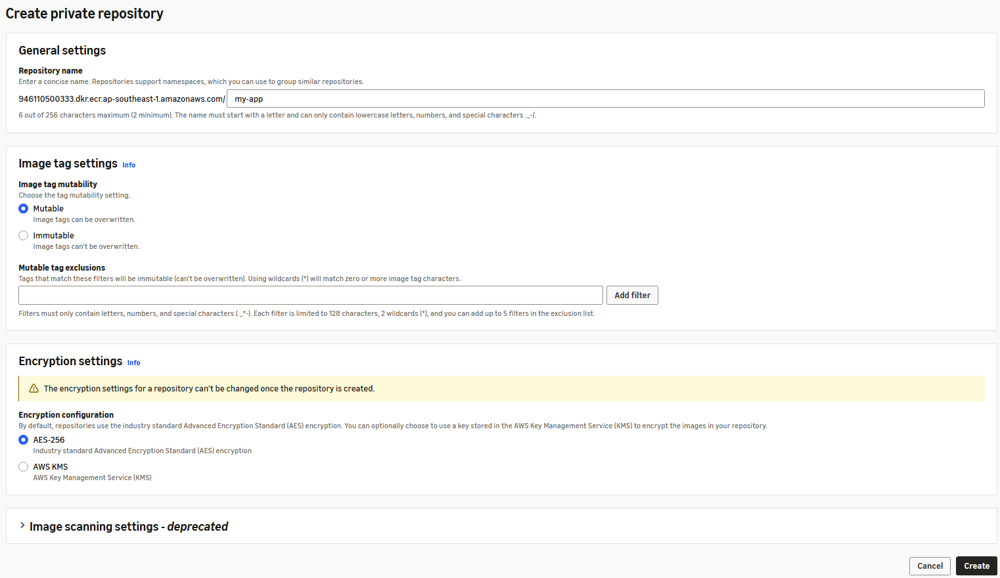
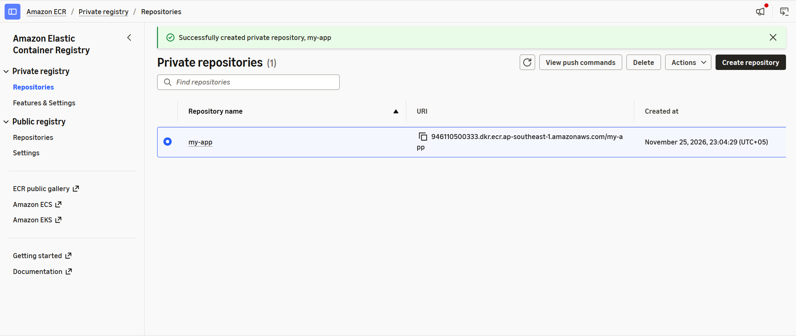
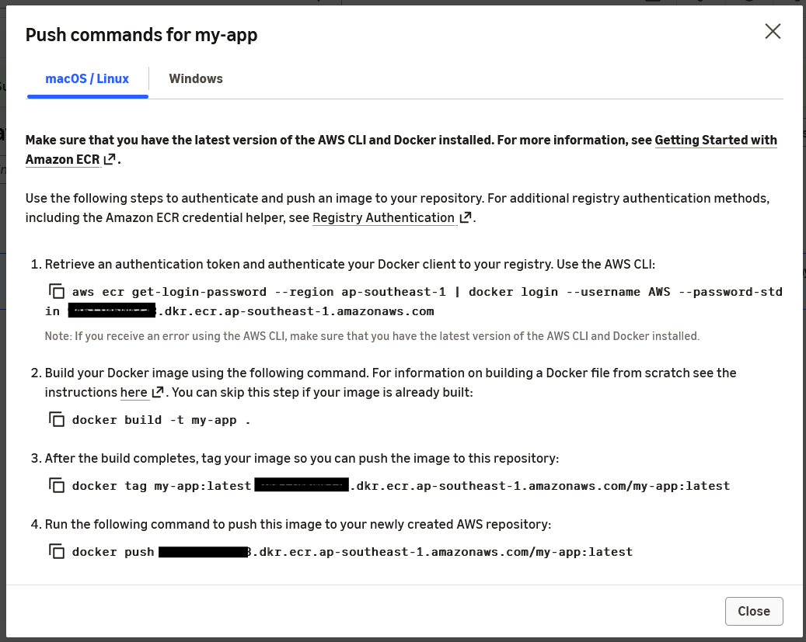

# Lab 8: Build Docker Images with Dockerfiles

**Execution environment:** Your assigned Ubuntu server  
**Submission repository:** `DevOps`  
**Submission directory:** `Labs/Lab08`  
**Screenshot directory:** `Labs/Lab08/screenshots`

Write Dockerfiles using Ubuntu. First, build an image that prints a text file. Then build an image that serves a small HTML page on port `3000`. Finally, compare how `CMD` and `ENTRYPOINT` handle arguments passed to `docker run`. The bonus task publishes a Docker image to AWS ECR.

```text
DevOps/
└── Labs/
    └── Lab08/
        ├── README.md
        ├── assets/
        │   └── (instructor reference images)
        ├── task1/
        │   ├── Dockerfile
        │   └── myfile
        ├── task2/
        │   └── Dockerfile
        ├── task3/
        │   ├── cmd/
        │   │   └── Dockerfile
        │   └── entrypoint/
        │       └── Dockerfile
        ├── bonus-ecr/
        │   └── Dockerfile
        └── screenshots/
            └── (your fourteen guided-task screenshots and bonus evidence)
```

The instructor supplies this README and the reference images in `assets/`. Create the task files and screenshots yourself. Create `bonus-ecr/` if you complete the bonus task.

## Lab Objective

By the end of this lab, you will be able to:

- Use `FROM`, `LABEL`, `COPY`, `RUN`, `ADD`, `WORKDIR` and `CMD` in a Dockerfile.
- Build and run an image, then read a container's logs.
- Use `ENV` and `EXPOSE` and publish a container port with `-p`.
- Keep a container running by starting a web server as its main application.
- Compare `CMD` and `ENTRYPOINT` by running images with and without extra arguments.
- In the bonus task, install the AWS CLI and push a Docker image to a private ECR repository.

## Prerequisites

- Complete Lab 7 and use Docker on your assigned Ubuntu server.
- Use your registered GitHub username as your Ubuntu username and `ubuntu` as your hostname.
- Have internet access for the Ubuntu image, package installation and the image downloaded by `ADD`.
- Have a text editor, browser and access to your existing `DevOps` repository.
- Port `3000` must be free on your Ubuntu server and reachable from your browser.

## Task List

- [Screenshot Rules](#screenshot-rules)
- [Required Screenshot Filenames](#required-screenshot-filenames)
- [Getting Started](#getting-started)
- [Task 1: Build an Ubuntu Image that Prints a File](#task-1-build-an-ubuntu-image-that-prints-a-file)
- [Task 2: Serve an HTML Page on Port 3000](#task-2-serve-an-html-page-on-port-3000)
- [Task 3: Compare CMD and ENTRYPOINT](#task-3-compare-cmd-and-entrypoint)
- [Bonus Task: Publish a Docker Image to AWS ECR](#bonus-task-publish-a-docker-image-to-aws-ecr)
- [Task 4](#task-4)
- [Summary](#summary)
- [Final Submission Checklist](#final-submission-checklist)
- [Submission](#submission)
- [Official References](#official-references)

---

## Screenshot Rules

Read these rules before starting.

**Exam evaluation screenshots are not graded.** They are for practice only and do not count toward the lab marks.

1. Use an Ubuntu account whose terminal prompt shows your registered GitHub username before `@` and `ubuntu` as the hostname:

   ```text
   YourGitHubUsername@ubuntu:~$
   ```

   The comparison is case-insensitive, but the spelling must match the `user_name` registered in the Student Marks Portal.

2. For terminal evidence, show your `YourGitHubUsername@ubuntu` prompt, the required commands and their output. For browser evidence, show the page and its address bar with your Ubuntu terminal prompt visible beside it.
3. Follow the screenshot instruction directly below each step. When a step asks for multiple commands in one screenshot, keep those commands and their relevant outputs together.
4. Save your screenshots inside `Labs/Lab08/screenshots/`.
5. Use the exact filenames and capitalization given below.
6. Keep the terminal text clear and readable.
7. Keep your screenshots unedited, with the required commands and their relevant output visible.
8. Do not expose real passwords, access tokens, private keys or other secrets.
9. Capture your own work. Do not copy or reuse another student's screenshots.
10. Commit and push your complete `Labs/Lab08` directory to your `DevOps` repository before the deadline.

### Required Screenshot Filenames

Lab 8 requires these 14 guided-task screenshots. Save them inside `Labs/Lab08/screenshots/` using the exact filenames below:

```text
task1_dockerfile.png
task1_image_build.png
task1_image_run.png
task1_container_logs.png
task2_web_files.png
task2_image_build.png
task2_container_running.png
task2_webpage.png
task3_cmd_dockerfile.png
task3_cmd_build.png
task3_cmd_run.png
task3_entrypoint_dockerfile.png
task3_entrypoint_build.png
task3_entrypoint_run.png
```

If you complete the bonus task, also save these 8 bonus screenshots in the same directory:

```text
bonus_aws_cli_version.png
bonus_ecr_repository.png
bonus_ecr_push_commands.png
bonus_dockerfile.png
bonus_ecr_login.png
bonus_image_build.png
bonus_image_push.png
bonus_ecr_image.png
```

---

## Getting Started

In your existing `DevOps` repository, create the task directories and the screenshot directory:

```bash
cd ~/DevOps
mkdir -p Labs/Lab08/task1 Labs/Lab08/task2 Labs/Lab08/task3/cmd Labs/Lab08/task3/entrypoint Labs/Lab08/screenshots
```

---

## Task 1: Build an Ubuntu Image that Prints a File

1. Prepare the build files:

   ```bash
   cd ~/DevOps/Labs/Lab08/task1
   echo "Hello from myfile" > myfile
   ```

   In the same directory, create a file named exactly `Dockerfile` with the following code. Replace the maintainer email with your own email address and use normal straight quotation marks:

   ```dockerfile
   FROM ubuntu
   LABEL maintainer="you@gmail.com"
   COPY myfile /app/
   RUN echo "my text" >> /app/myfile
   ADD https://www.python.org/static/community_logos/python-logo.png /app/
   WORKDIR /app
   CMD ["cat", "myfile"]
   ```

   `COPY` puts your local `myfile` into `/app/`. `RUN` appends a line while building the image. `ADD` downloads `python-logo.png` from Python's public website. This is a direct static image URL with no expiry token. `CMD` prints `myfile` when the container starts.

   - Screenshot as `task1_dockerfile.png`, showing the complete Dockerfile and your Ubuntu terminal prompt.

2. Build the image from this directory:

   ```bash
   docker build -t my-ubuntu:1.0 .
   ```

   - Screenshot as `task1_image_build.png`, showing the build command and its successful result.

3. List the images and run the new image. Give the container a name so it can be used in the next step:

   ```bash
   docker images
   docker run --name my-ubuntu-demo my-ubuntu:1.0
   ```

   The container prints:

   ```text
   Hello from myfile
   my text
   ```

   It then exits because `cat` has finished.

   - Screenshot as `task1_image_run.png`. Show both commands in **one screenshot**, including the `my-ubuntu` image with tag `1.0` and the printed file contents.

4. Read the output saved for that container:

   ```bash
   docker logs my-ubuntu-demo
   ```

   Use the container name `my-ubuntu-demo` here. `my-ubuntu:1.0` is the image tag. The logs show the same two lines, even though this container has exited.

   - Screenshot as `task1_container_logs.png`, showing the logs command and both lines of output.

**Screenshot Required:**

- `task1_dockerfile.png`
- `task1_image_build.png`
- `task1_image_run.png`
- `task1_container_logs.png`

---

## Task 2: Serve an HTML Page on Port 3000

1. Create the Dockerfile in a separate directory:

   ```bash
   cd ~/DevOps/Labs/Lab08/task2
   ```

   Create `Dockerfile` in this directory. It will generate `index.html` inside the image:

   ```dockerfile
   FROM ubuntu
   LABEL maintainer="you@gmail.com"
   RUN apt-get update && apt-get install -y python3
   ENV PAGE_TITLE="DevOps"
   WORKDIR /app
   RUN echo "<title>$PAGE_TITLE</title><h1>I am a DevOps engineer</h1>" > index.html
   EXPOSE 3000
   CMD ["python3", "-m", "http.server", "3000", "--bind", "0.0.0.0"]
   ```

   **ENV situation:** The webpage title must come from an environment variable. `ENV PAGE_TITLE="DevOps"` provides the value. During the build, `RUN echo` creates a one-line `index.html` with that value in the browser tab title and the fixed heading `I am a DevOps engineer`. Keep `ENV PAGE_TITLE` before this `RUN` instruction. To change the title, edit the `ENV` value and rebuild the image.

   `EXPOSE 3000` records the container port. The square-bracket `CMD` starts Python's web server on the fixed port `3000`, serving the current working directory. The server keeps running, so the container stays running.

   - Screenshot as `task2_web_files.png`, showing the complete Dockerfile, including `ENV PAGE_TITLE`, `RUN echo` and your Ubuntu terminal prompt.

2. Build the second image:

   ```bash
   docker build -t my-ubuntu:1.1 .
   ```

   - Screenshot as `task2_image_build.png`, showing the build command and its successful result.

3. Start the web container in the background and check that it is running:

   ```bash
   docker run -d --name my-ubuntu-web -p 3000:3000 my-ubuntu:1.1
   ```

   ```bash
   docker ps
   ```

   Keep the image name `my-ubuntu:1.1` consistent between the build and run commands. `-d` returns control to your terminal while the web server runs. `-p 3000:3000` maps port `3000` on the Ubuntu server to port `3000` in the container. `EXPOSE` alone does not publish the port.

   - Screenshot as `task2_container_running.png`, showing both commands and the `my-ubuntu-web` container with an `Up` status and the `3000` port mapping.

4. In your browser, open `http://<server-ip>:3000`. Replace `<server-ip>` with the IP address of your Ubuntu server. Confirm that the browser tab title shows **DevOps** and the page heading shows **I am a DevOps engineer**.

   - Screenshot as `task2_webpage.png`, showing the browser tab title, the page heading, the address bar with port `3000`, and your Ubuntu terminal prompt beside the browser.

**Screenshot Required:**

- `task2_web_files.png`
- `task2_image_build.png`
- `task2_container_running.png`
- `task2_webpage.png`

---

## Task 3: Compare CMD and ENTRYPOINT

1. Create the first Dockerfile in the `task3/cmd` directory:

   ```bash
   cd ~/DevOps/Labs/Lab08/task3/cmd
   ```

   Create a file named exactly `Dockerfile` with this code:

   ```dockerfile
   FROM ubuntu
   CMD ["echo", "Hello from CMD"]
   ```

   - Screenshot as `task3_cmd_dockerfile.png`, showing the complete Dockerfile and your Ubuntu terminal prompt.

2. Build the image with the tag `my-image:cmd`:

   ```bash
   docker build -t my-image:cmd .
   ```

   - Screenshot as `task3_cmd_build.png`, showing the build command and its successful result.

3. Run the image with its default command:

   ```bash
   docker run my-image:cmd
   ```

   Expected output:

   ```text
   Hello from CMD
   ```

   Run it again with a command after the image name:

   ```bash
   docker run my-image:cmd ls -l
   ```

   `ls -l` replaces the Dockerfile's `CMD`. This container lists the files and directories in its working directory instead of printing `Hello from CMD`. Each container exits after its command finishes.

   - Screenshot as `task3_cmd_run.png`. Show both run commands in **one screenshot**, including `Hello from CMD` from the first run and the directory listing from the second run.

4. Create the second Dockerfile in the `task3/entrypoint` directory:

   ```bash
   cd ~/DevOps/Labs/Lab08/task3/entrypoint
   ```

   Create a file named exactly `Dockerfile` with this code:

   ```dockerfile
   FROM ubuntu
   ENTRYPOINT ["echo", "Hello from ENTRYPOINT"]
   ```

   - Screenshot as `task3_entrypoint_dockerfile.png`, showing the complete Dockerfile and your Ubuntu terminal prompt.

5. Build the image with the tag `my-image:entrypoint`:

   ```bash
   docker build -t my-image:entrypoint .
   ```

   - Screenshot as `task3_entrypoint_build.png`, showing the build command and its successful result.

6. Run the image with its entrypoint:

   ```bash
   docker run my-image:entrypoint
   ```

   Expected output:

   ```text
   Hello from ENTRYPOINT
   ```

   Run it again with `goodbye` after the image name:

   ```bash
   docker run my-image:entrypoint goodbye
   ```

   Expected output:

   ```text
   Hello from ENTRYPOINT goodbye
   ```

   With this square-bracket `ENTRYPOINT`, Docker appends `goodbye` to the existing command. The container runs `echo` with both `Hello from ENTRYPOINT` and `goodbye` as its arguments, then exits.

   - Screenshot as `task3_entrypoint_run.png`. Show both run commands and their outputs in **one screenshot**.

**Screenshot Required:**

- `task3_cmd_dockerfile.png`
- `task3_cmd_build.png`
- `task3_cmd_run.png`
- `task3_entrypoint_dockerfile.png`
- `task3_entrypoint_build.png`
- `task3_entrypoint_run.png`

---

## Bonus Task: Publish a Docker Image to AWS ECR

Install the AWS CLI, create a private Amazon Elastic Container Registry (ECR) repository, and publish a simple image as `my-app:latest`.

The reference screenshots below show the instructor's example. Use your own AWS account and capture your own required screenshots.

**Before you start:** Use a 64-bit `x86_64` Ubuntu server for the installer below. Have an AWS account and an IAM identity with permission to create and view an ECR repository, authenticate Docker, and push images. Use the same AWS account and Region in the CLI and console. This example uses `ap-southeast-1`.

1. Install the AWS CLI on your Ubuntu server. If AWS CLI v2 is already installed, skip the installation commands and run `aws --version` below. If `curl` or `unzip` is missing, install them first:

   ```bash
   sudo apt install -y curl unzip
   ```

   Keep the installer outside your `DevOps` repository:

   ```bash
   cd /tmp
   ```

   ```bash
   curl "https://awscli.amazonaws.com/awscli-exe-linux-x86_64.zip" -o "awscliv2.zip"
   ```

   ```bash
   unzip awscliv2.zip
   ```

   ```bash
   sudo ./aws/install
   ```

   Verify the installed version:

   ```bash
   aws --version
   ```

   - Screenshot as `bonus_aws_cli_version.png`, showing **only the `aws --version` command**, its installed version and your Ubuntu terminal prompt. Installation-command screenshots are not required.

2. Configure the AWS CLI:

   ```bash
   aws configure
   ```

   Enter these four values when prompted:

   - **AWS Access Key ID:** your access key ID.
   - **AWS Secret Access Key:** your secret access key.
   - **Default region name:** `ap-southeast-1`.
   - **Default output format:** `json`.

   **No screenshot is required for `aws configure` because it involves credentials.** Clear the configuration output from your terminal before capturing later screenshots. Keep your AWS credentials outside the Git repository; do not include `~/.aws/credentials` or `~/.aws/config` in your submission.

3. In the [AWS Management Console](https://console.aws.amazon.com/), press **Alt+S**, type **ECR**, and select **Elastic Container Registry** from the search results. If the shortcut is intercepted by your browser, click the console search box.

   

   Select **ap-southeast-1 (Singapore)** in the Region selector. On the ECR welcome page, choose **Create** under **Create a repository**. If you are already on the repository list, choose **Private registry → Repositories → Create repository**.

   

   Set **Repository name** to `my-app`, choose **Mutable** for image tags and **AES-256** for encryption, then choose **Create**.

   

   

   - Screenshot as `bonus_ecr_repository.png`, showing that the private repository `my-app` was created, its repository URI and Region, with your Ubuntu terminal prompt beside the browser.

4. In the private repository list, select the **radio button** beside `my-app`, then choose **View push commands**. Select the **macOS / Linux** tab.

   

   Read the four commands in the dialog. They log Docker in to ECR, build the image, add its ECR tag, and push it. Prepare the Dockerfile in the next step, then run these four commands one at a time in the order shown below.

   **Use your own registry address:** Copy the commands from your dialog. In the examples below, replace `YOUR_AWS_ACCOUNT_ID` with the 12-digit account ID in that dialog. If you chose another Region, replace `ap-southeast-1` everywhere with that Region.

   - Screenshot as `bonus_ecr_push_commands.png`, showing all four commands in the `my-app` push dialog and your Ubuntu terminal prompt beside the browser.

5. Create a separate directory for the bonus image:

   ```bash
   mkdir -p ~/DevOps/Labs/Lab08/bonus-ecr
   ```

   ```bash
   cd ~/DevOps/Labs/Lab08/bonus-ecr
   ```

   Create a file named exactly `Dockerfile` with this simple code:

   ```dockerfile
   FROM ubuntu
   CMD ["echo", "Hello from my-app"]
   ```

   The image will print `Hello from my-app` when run. Keep this terminal in `bonus-ecr` for the next steps so that Docker can find the Dockerfile.

   - Screenshot as `bonus_dockerfile.png`, showing the complete Dockerfile and your Ubuntu terminal prompt.

6. Run **command 1** from the push dialog to log Docker in to your registry:

   ```bash
   aws ecr get-login-password --region ap-southeast-1 | docker login --username AWS --password-stdin YOUR_AWS_ACCOUNT_ID.dkr.ecr.ap-southeast-1.amazonaws.com
   ```

   The AWS CLI obtains an ECR login token and passes it directly to Docker through `--password-stdin`. Successful authentication displays `Login Succeeded`.

   - Screenshot as `bonus_ecr_login.png`, showing the login command and `Login Succeeded`. Keep all earlier credential-entry output out of the screenshot.

7. Run **command 2** from the push dialog to build the image from your Dockerfile:

   ```bash
   docker build -t my-app .
   ```

   The final `.` is the current build directory. Docker uses the tag `latest` when no tag is supplied, so this creates the local image `my-app:latest`.

   - Screenshot as `bonus_image_build.png`, showing the build command and its successful result.

8. Run **command 3** from the push dialog to tag the local image with its ECR destination:

   ```bash
   docker tag my-app:latest YOUR_AWS_ACCOUNT_ID.dkr.ecr.ap-southeast-1.amazonaws.com/my-app:latest
   ```

   This adds an ECR name to the local image. It does not upload the image yet.

   Run **command 4** to upload it:

   ```bash
   docker push YOUR_AWS_ACCOUNT_ID.dkr.ecr.ap-southeast-1.amazonaws.com/my-app:latest
   ```

   Wait for the push to finish. The output includes the uploaded image's digest.

   - Screenshot as `bonus_image_push.png`, showing both commands in **one screenshot**, with the successful push and image digest.

9. Return to the ECR console, close the push-command dialog, and open the **my-app** repository. Choose **Images** and refresh the list.

   Confirm that the repository contains an image tagged **latest**. In ECR, `my-app` is the repository name and `latest` is its image tag; together they identify `my-app:latest`.

   - Screenshot as `bonus_ecr_image.png`, showing the `my-app` repository name and the published image tagged `latest`, with the browser address bar and your Ubuntu terminal prompt beside it.

**Screenshot Required (Bonus Task):**

- `bonus_aws_cli_version.png`
- `bonus_ecr_repository.png`
- `bonus_ecr_push_commands.png`
- `bonus_dockerfile.png`
- `bonus_ecr_login.png`
- `bonus_image_build.png`
- `bonus_image_push.png`
- `bonus_ecr_image.png`

---

## Task 4

Continue

---

## Summary

- You built `my-ubuntu:1.0` and ran its default command to print a file.
- You downloaded a public image during the build and viewed the container logs by container name.
- You used `ENV PAGE_TITLE` and `RUN echo` to generate the HTML title and a fixed heading while building `my-ubuntu:1.1`, and served the page on the fixed port `3000`.
- You published port `3000` and viewed the running container's webpage in a browser.
- You replaced `CMD` with `ls -l` and appended `goodbye` to an `ENTRYPOINT` command.
- If you completed the bonus task, you installed the AWS CLI and published `my-app:latest` to your private ECR repository.

## Final Submission Checklist

- [ ] Task 1 contains my `Dockerfile` and `myfile`.
- [ ] Task 2 contains my `Dockerfile` with `ENV PAGE_TITLE` and `RUN echo` to generate `index.html` inside the image.
- [ ] Task 3 contains separate `cmd/Dockerfile` and `entrypoint/Dockerfile` files.
- [ ] All four Docker images built successfully with the required tags.
- [ ] The first container printed both lines and its logs show the same output.
- [ ] `my-ubuntu-web` is running and the webpage is visible on port `3000`.
- [ ] Task 3 shows the default `CMD`, its replacement by `ls -l`, and both `ENTRYPOINT` runs.
- [ ] All fourteen screenshots use the exact filenames in `Labs/Lab08/screenshots/`.
- [ ] If I completed the bonus task, `bonus-ecr/Dockerfile` and all eight bonus screenshots are saved, including ECR evidence of `my-app:latest`.
- [ ] My complete `DevOps/Labs/Lab08` directory is visible on GitHub.

## Submission

Save your files and screenshots for Tasks 1–3 now. Include the bonus task files and screenshots if you complete it. Submit the URL of your own `DevOps/Labs/Lab08` directory after all Lab 8 tasks are published and completed.

## Official References

- [Docker: Dockerfile reference](https://docs.docker.com/reference/dockerfile/)
- [Docker: How CMD and ENTRYPOINT interact](https://docs.docker.com/reference/dockerfile/#understand-how-cmd-and-entrypoint-interact)
- [Docker: Container logs](https://docs.docker.com/reference/cli/docker/container/logs/)
- [Docker: Port publishing and mapping](https://docs.docker.com/engine/network/port-publishing/)
- [Python: Simple HTTP server](https://docs.python.org/3/library/http.server.html)
- [Python: Public logo image used by ADD](https://www.python.org/static/community_logos/python-logo.png)
- [AWS: Install AWS CLI v2 on Linux](https://docs.aws.amazon.com/cli/latest/userguide/getting-started-install.html)
- [AWS: Configure the AWS CLI](https://docs.aws.amazon.com/cli/latest/reference/configure/)
- [AWS: Search for services in the console](https://docs.aws.amazon.com/awsconsolehelpdocs/latest/gsg/unified-search-regular.html)
- [AWS: Create a private ECR repository](https://docs.aws.amazon.com/AmazonECR/latest/userguide/repository-create.html)
- [AWS: IAM permissions for pushing images](https://docs.aws.amazon.com/AmazonECR/latest/userguide/image-push-iam.html)
- [AWS: Push a Docker image to ECR](https://docs.aws.amazon.com/AmazonECR/latest/userguide/docker-push-ecr-image.html)
- [AWS: View images in a private ECR repository](https://docs.aws.amazon.com/AmazonECR/latest/userguide/repository-info.html)
